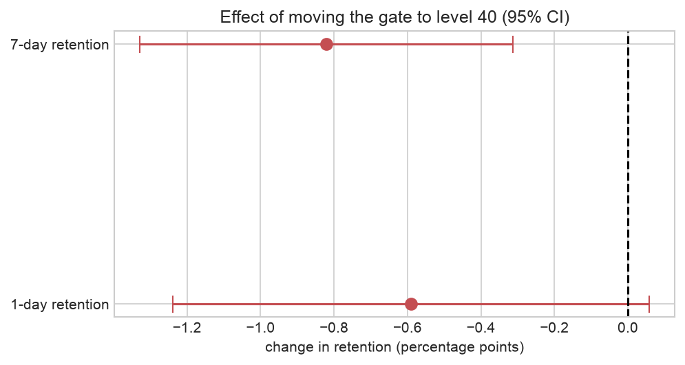
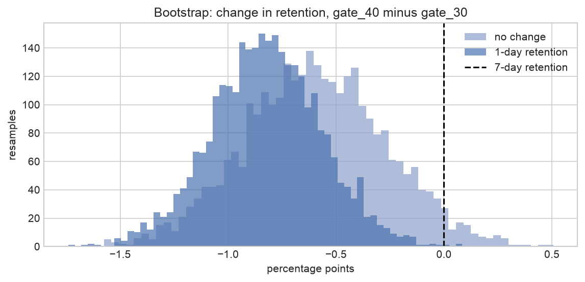

# A/B Test Analysis: Should a Mobile Game Move Its First Paywall Gate?

A complete, decision-focused analysis of a real A/B test on **90,189 players** of the mobile game *Cookie Cats*: sanity checks, power analysis, frequentist and Bayesian tests, bootstrap, and a clear recommendation.

   

**Read the full analysis: [`notebooks/ab_test_analysis.ipynb`](notebooks/ab_test_analysis.ipynb)**

## The question

Players hit a "gate" in the game where they must wait or pay to continue. The team tested moving the first gate from **level 30** (control) to **level 40** (treatment). Should they ship it?

## Recommendation: keep the gate at level 30



| Metric | gate_30 | gate_40 | Change | 95% CI | p-value | P(gate_30 better) |
|---|---|---|---|---|---|---|
| **7-day retention (primary)** | 19.02% | 18.20% | **-0.82 pp (-4.3%)** | -1.33 to -0.31 pp | **0.002** | **99.9%** |
| 1-day retention | 44.82% | 44.23% | -0.59 pp | -1.24 to +0.06 pp | 0.074 | 96.3% |
| Game rounds, first 14 days (capped mean) | 51.0 | 50.9 | ~0 | - | 0.05 (rank test) | - |

- Moving the gate to level 40 **lowers 7-day retention** - the metric most linked to long-term revenue.
- There is **no engagement gain** to offset the loss.
- Likely reason: an earlier break keeps the game enjoyable for longer, so players come back.

## What makes this analysis more than a t-test

**1. Sample Ratio Mismatch check.** The split is 49.6% / 50.4%, which is statistically unlikely under a 50/50 design (chi-square p = 0.009). I flag this instead of ignoring it: in a real company the assignment pipeline must be checked before the result is final.

**2. Data quality.** One player logged **49,854 rounds** in 14 days (a bot or logging error). It does not affect retention, but it would distort averages, so engagement uses medians, a rank test and a capped mean.

**3. Power analysis.** With ~45k players per group the test could detect changes of **0.74 pp** (7-day) and **0.93 pp** (1-day). The 7-day effect is above this line; the 1-day effect is not, so "not significant" there means "not enough data", not "no effect".

**4. Three statistical views that agree.** Two-proportion z-test, bootstrap (3,000 resamples) and a Bayesian Beta-Binomial model all point the same way. The Bayesian model also gives the **expected loss**: shipping gate_40 is expected to cost ~0.8 pp of 7-day retention; keeping gate_30 costs almost nothing.



**5. Why not to peek.** A simulation of A/A tests (no real difference) shows that checking results **14 times** and stopping at the first p < 0.05 gives a **22% false-positive rate** instead of the promised 5%.

**6. No post-treatment segmentation.** Results are not split by "rounds played", because that variable is itself changed by the treatment and would bias the comparison.

## Follow-ups I would propose

1. Investigate the sample ratio mismatch with engineering.
2. Track revenue at the gate, not only retention.
3. Test an earlier gate (e.g. level 20) to see if the effect continues.

## Project structure

```
├── notebooks/ab_test_analysis.ipynb   # the full analysis, executed with outputs
├── src/abtest.py                      # reusable functions: SRM, z-test, bootstrap, Bayesian, power, peeking
├── tests/test_abtest.py               # unit tests (z-test checked against statsmodels)
├── data/cookie_cats.csv               # 90,189 players
└── reports/                           # results.json and figures
```

## How to run

```bash
python -m venv .venv && source .venv/bin/activate
pip install -r requirements.txt
pytest -q                                   # 4 tests
jupyter notebook notebooks/ab_test_analysis.ipynb
```

`src/abtest.py` is written to be reused for any conversion-rate experiment, for example:

```python
from src.abtest import two_proportion_ztest, required_n_per_group
two_proportion_ztest(success_a=8502, n_a=44700, success_b=8279, n_b=45489)
required_n_per_group(p_base=0.19, mde_abs=0.005)   # users needed per group to detect a 0.5 pp change
```

## Data

The *Cookie Cats* A/B test dataset (Tactile Entertainment), as published for DataCamp's project and mirrored on [GitHub](https://github.com/robguilarr/ab_testing_cookie_cats). Columns: `userid`, `version`, `sum_gamerounds`, `retention_1`, `retention_7`.
